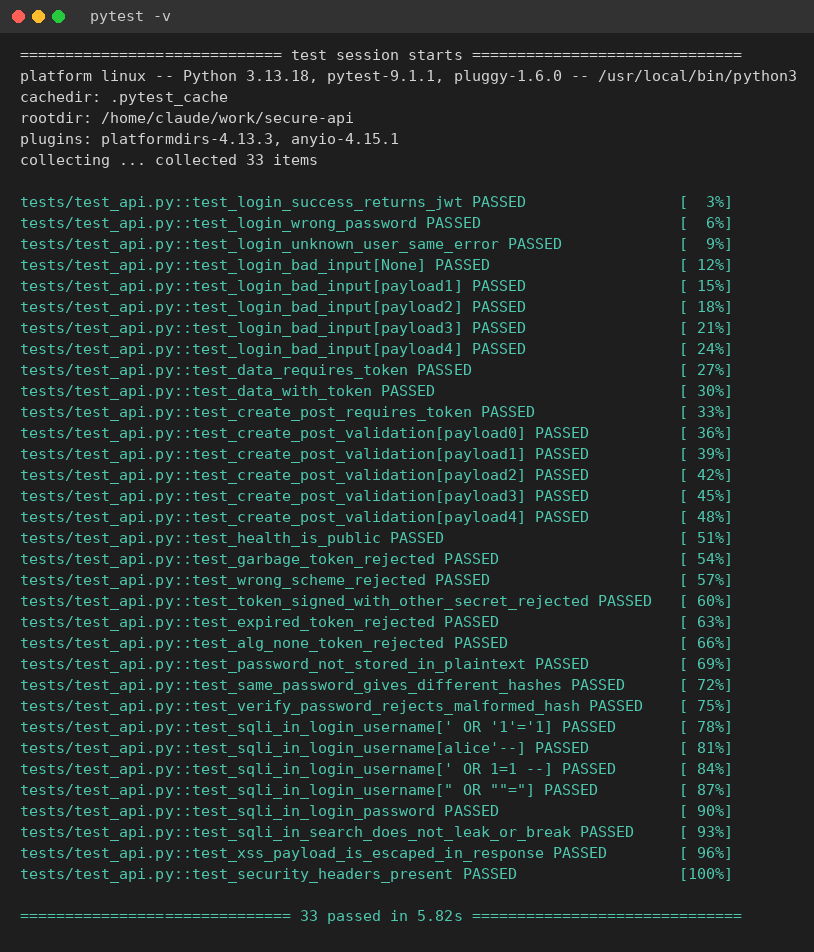
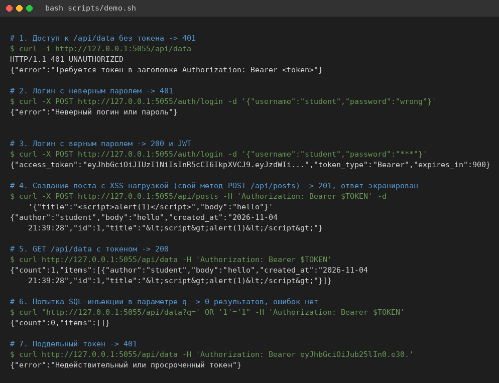

# secure-api — защищённый REST API с CI/CD

Учебный backend на **Python / Flask + SQLite** для лабораторной работы №1 по дисциплине «Информационная безопасность».
В проекте реализованы меры защиты от SQL-инъекций, XSS и Broken Authentication (JWT + хэширование паролей), а в GitHub Actions
на каждый push и pull request запускаются тесты и security-сканеры (SAST и SCA).

## Быстрый старт

```bash
python -m venv .venv && source .venv/bin/activate
pip install -r requirements-dev.txt

export JWT_SECRET="$(python -c 'import secrets; print(secrets.token_hex(32))')"
export DATABASE_PATH=app.db
python manage.py create-user student          # пароль спросит интерактивно (минимум 8 символов)

flask --app app run --port 5000
```

Тесты: `pytest -v` · автоматическая демонстрация через curl: `bash scripts/demo.sh`.

Переменные окружения: `JWT_SECRET` (секрет подписи токенов, **не хранится в коде**), `DATABASE_PATH` (путь к SQLite-файлу).

## API

| Метод | Путь | Доступ | Описание |
|---|---|---|---|
| POST | `/auth/login` | публичный | Принимает `{"username","password"}`, возвращает JWT |
| GET | `/api/data` | **только с токеном** | Список постов; необязательный фильтр `?q=текст` |
| POST | `/api/posts` | **только с токеном** | (свой метод) создание поста `{"title","body"}` от имени пользователя из токена |
| GET | `/health` | публичный | Проверка живости сервиса |

Примеры:

```bash
# 1. получить токен
curl -X POST http://127.0.0.1:5000/auth/login \
     -H 'Content-Type: application/json' \
     -d '{"username":"student","password":"<пароль>"}'
# -> {"access_token":"eyJ...","token_type":"Bearer","expires_in":900}

# 2. создать пост
curl -X POST http://127.0.0.1:5000/api/posts \
     -H "Authorization: Bearer $TOKEN" -H 'Content-Type: application/json' \
     -d '{"title":"Привет","body":"Первый пост"}'

# 3. получить данные
curl http://127.0.0.1:5000/api/data -H "Authorization: Bearer $TOKEN"

# 4. без токена -> 401
curl -i http://127.0.0.1:5000/api/data
```

Коды ответов: `200/201` — успех, `400` — некорректный ввод, `401` — нет или неверный токен / неверные учётные данные,
`413` — слишком большое тело запроса.

## Реализованные меры защиты

### Защита от SQL-инъекций (A03:2021 — Injection)
Все запросы к БД, в которые попадают данные пользователя (`username` при логине, `q` в поиске, поля нового поста, `id` автора),
выполняются **параметризованно**: SQL-текст содержит плейсхолдеры `?`, а значения передаются отдельным аргументом
(`db.execute("... WHERE username = ?", (username,))`). Драйвер никогда не подставляет данные в SQL как текст, поэтому
нагрузки вроде `' OR '1'='1` или `'; DROP TABLE posts;--` воспринимаются как обычная строка. Конкатенации и f-строк в SQL
для пользовательских данных в проекте нет (даже шаблон `%q%` для `LIKE` собирается в Python и передаётся параметром).
Дополнительно проверяется тип и длина входных данных. Покрыто тестами `test_sqli_*`.

### Защита от XSS (A03:2021)
Все пользовательские строки, которые возвращаются в ответах (`title`, `body`, `author`), экранируются функцией
`markupsafe.escape` (`<` → `&lt;`, `>` → `&gt;`, `"` → `&#34;` и т. д.), поэтому `<script>alert(1)</script>` приходит клиенту
как безопасный текст. Сверх этого: заголовок `Content-Security-Policy: default-src 'none'`, `X-Content-Type-Options: nosniff`,
`X-Frame-Options: DENY`, `Cache-Control: no-store`. Покрыто тестами `test_xss_*`.

### Аутентификация (A07:2021 — Identification and Authentication Failures)
* **Хэширование паролей.** Пароли хранятся только в виде хэша **scrypt** (`hashlib.scrypt`, N=2^15, r=8, p=1) с уникальной
  случайной солью 16 байт для каждого пользователя; формат `scrypt$N$r$p$salt$hash`. Сравнение выполняется за постоянное время
  (`hmac.compare_digest`). Пароль в открытом виде не хранится и не логируется.
* **JWT.** После успешного логина выдаётся токен HS256 с полями `sub`, `username`, `iat`, `exp` (15 минут) и `iss`.
  Секрет берётся из переменной окружения `JWT_SECRET`.
* **Middleware.** Хук `before_request` проверяет заголовок `Authorization: Bearer <token>` для **всех** эндпоинтов, кроме
  явного списка публичных (`/auth/login`, `/health`) — принцип *deny by default* (A01:2021 — Broken Access Control). При проверке
  фиксирован алгоритм (`algorithms=["HS256"]`), обязательны `exp/iat/sub/iss`; токены с `alg=none`, чужой подписью или
  истёкшим сроком получают `401`.
* **Защита от перечисления пользователей.** Для неизвестного логина и для неверного пароля возвращается одинаковый ответ,
  а проверка выполняется против «пустого» хэша, чтобы время ответа не выдавало существование логина.
* Ограничение размера тела запроса (16 КБ), строгая валидация типов и длины полей.

## CI/CD (GitHub Actions)

Файл [`.github/workflows/ci.yml`](.github/workflows/ci.yml) запускается **при каждом push и pull request**:

| Job | Инструмент | Тип | Что проверяет |
|---|---|---|---|
| `test` | pytest | тесты | 33 теста: функциональность, JWT, SQLi, XSS, хэширование |
| `sast` | **bandit** | SAST | небезопасные конструкции в коде приложения (падает при severity ≥ MEDIUM) |
| `sca` | **pip-audit** | SCA | известные уязвимости в зависимостях из `requirements.txt` |
| `dependency-check` | **OWASP Dependency-Check** | SCA | дополнительный анализ зависимостей по NVD (не блокирующий) |

Отчёты bandit и pip-audit сохраняются как артефакты запуска.

## Результаты

### Тесты и ручная проверка через curl




### Отчёты SAST / SCA из GitHub Actions

<!-- TODO: после первого запуска pipeline добавить скриншоты в docs/screenshots/ и раскомментировать:


-->

Ссылка на последний успешный запуск pipeline: _<вставить ссылку на запуск в разделе Actions>_
